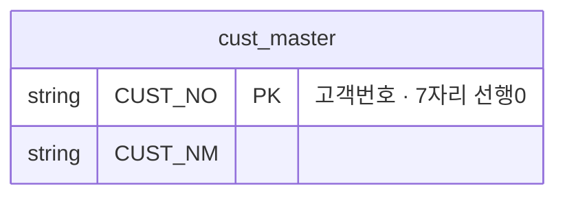

# AS-IS 모델 — 원천 3종을 있는 그대로

작성자: (이름) · 2026-10-08

- 엔터티 이름 = 원천 파일 이름(확장자 뺌), 속성 이름 = 원천 컬럼 이름 **그대로**.
- 설명("...") 칸에는 셀 3~6 에서 확인한 사실을 짧게 적는다. 예: "36행 빈 값", "표기 12종"
- 원천끼리 값으로 이어지는 곳은 **점선(..)** 으로. 셀 7 결과를 설명에.
- 그림 보기: VS Code 탭 오른쪽 위 "측면에서 미리 보기 열기" 아이콘 (Ctrl+K → V). 안 되면 https://mermaid.live 에 블록을 붙여 넣기

## AS-IS 문제점

| # | 문제 | 근거 (셀 · 숫자) | TO-BE 에서 |
|---|---|---|---|
| 1 | | | |
| 2 | | | |
| 3 | | | |
