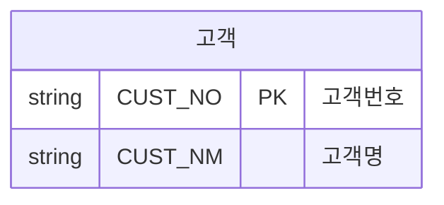

# TO-BE 개념 모델

작성자: (이름) · 2026-10-08

- 속성 이름은 2일차 표준 사전 「용어」 의 **물리명**만 쓴다.
- 주문 단위 속성은 주문, 항목 단위 속성은 주문항목 (셀 4 판정).
- 그림 보기: VS Code 탭 오른쪽 위 "측면에서 미리 보기 열기" 아이콘 (Ctrl+K → V)
- 관계 기호: `||` 정확히 1 · `|o` 0 또는 1 · `|{` 1 이상 · `o{` 0 이상 (오른쪽 끝 기준)

## 설계 결정

| 결정 | 이유 |
|---|---|
| | |
| | |
